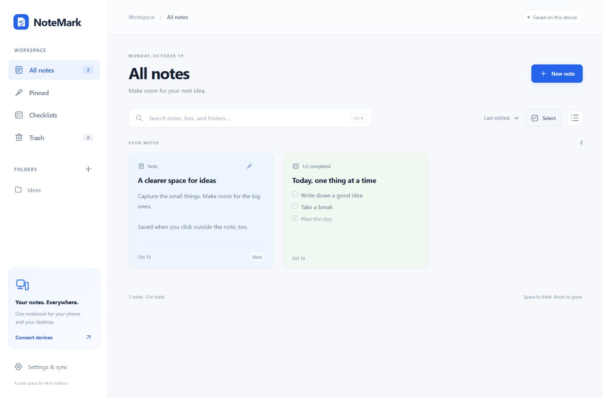

# NoteMark

**Your notes, on your devices.** NoteMark is an offline-first notes and checklists app for Windows and Android. Capture thoughts on one device, then sync your notebook over your local network or through your own hosted server.

## Features

- Notes and checklists save as you type, even before pressing Add.
- Drag checklist items to reorder them; completed items have their own section.
- Search, pin, organize in folders, use colors, and restore notes from Trash.
- Link devices with a private connection code. Sync payloads are encrypted before reaching the server.
- Export a ZIP with readable Markdown files and restore a ZIP or older Mira Notes JSON backup.

## Installation

The project currently has Windows x64 and Android 8+ builds. Once published, download the installer or APK from this repository's Releases page. Run the Windows Setup executable and install the APK on your Android device. These are local builds: Windows is unsigned, and the existing Android builds use a development signing identity. Only install a release when you trust its source. For setup and upgrade details see [Quick start](QUICK-START.md).

## Connect your devices

For local sync, connect both devices to the same Wi-Fi. On Android, open Settings & sync and choose **Host from this phone**. Copy its connection code; on Windows select **Connect a device** and paste it. Keep the phone's app in the foreground while it hosts. The Windows app can also host when the phone can reach it. Connection codes contain secrets: share them only with devices you trust.

For sync over the internet, run your own HTTPS server following [the deployment guide](deploy/README.md), then create and join the same notebook on each device. No public hosted server is included. Offline changes sync after the devices reconnect.

## Privacy and backups

Notes sent to the server are encrypted; server authentication stores token hashes. Local notes and device keys are readable by the device, and exported backups contain readable text. Losing every copy of the connection key prevents recovery from server ciphertext. This project has not had an independent security audit.

## Build from source

The Windows build uses Node.js 24+, npm and PowerShell. Run `npm ci`, then `npm start` to run from source. `npm run build:windows` builds a portable app and `npm run build:setup` builds its installer.

For Android install JDK 17 and Android SDK Platform 36 / build-tools 36.0.0, set `JAVA_HOME` and `ANDROID_HOME`, then run `npm run build:android` in PowerShell. A fresh checkout creates a **development key with a public password**; a build signed with that key is for development and cannot update an APK signed by another key. Preserve your own signing identity privately and use a protected production key for distribution. See [Android build notes](android/README.md). The repository excludes the original signing key.

## Contributing and status

The current source is 1.1.9. See [verification](VERIFICATION.md) for previous checks and limitations, [contributing](CONTRIBUTING.md) for issue reports and [security](SECURITY.md) for reporting vulnerabilities. If NoteMark is useful, consider starring the repository.

## License

Available under the [MIT license](LICENSE). Third-party components retain their own licenses; the bundled fflate notice is in `web/vendor/`.
